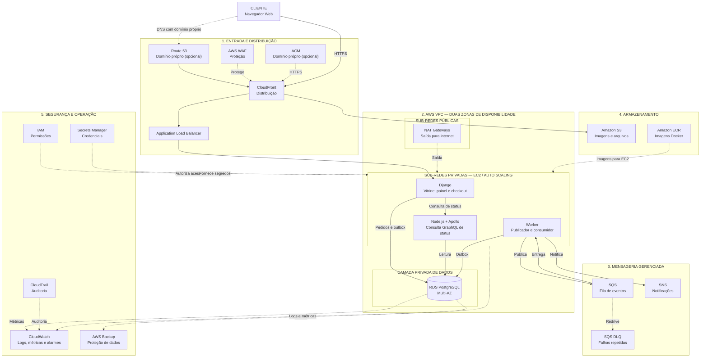

# ByteBistro

Projeto da disciplina de Sistemas Distribuídos para gestão de cardápios e pedidos em restaurantes.

- **Equipe** Pedro Antonio, Tauan Gomes e Augusto Fagner
- **Professor** Levi Costa

## Diagrama de infraestrutura AWS

O diagrama mostra a configuração distribuída definida em Terraform. A demonstração pública roda em uma EC2 separada. [Detalhes do diagrama](docs/architecture/aws-architecture.md)



## Entrega acadêmica

- **Cliente.** Cardápio com busca e categorias, personalização de itens, carrinho, pedidos na mesa ou por delivery e acompanhamento.
- **Equipe do restaurante.** Painel com acesso por perfil, fila de pedidos, cozinha, mesas, catálogo, estoque e registro de recebimentos.
- **Demonstração.** A versão local roda com Django e SQLite e permite testar o delivery com o código de verificação no terminal. A vitrine também pode ser acessada na EC2. [Demonstração pública](https://54.209.48.237/)
- **Integração distribuída.** O projeto implementa consulta de status via Apollo/GraphQL e Prisma com PostgreSQL e um worker para SQS/SNS. As três imagens do release foram publicadas no ECR.

## Executar localmente

A demonstração usa Django e SQLite. Com Python 3.11 ou 3.12, execute na raiz do repositório no PowerShell.

```powershell
cd apps/web
python -m venv .venv
.\.venv\Scripts\python -m pip install -r requirements.txt
.\.venv\Scripts\python manage.py migrate
.\.venv\Scripts\python manage.py runserver
```

Abra a [vitrine](http://127.0.0.1:8000/). Para acessar o [painel](http://127.0.0.1:8000/painel/), crie uma conta com `.\.venv\Scripts\python manage.py createsuperuser` em `apps/web`. Execute `.\.venv\Scripts\python manage.py test` para rodar os testes do Django.

Para uma avaliação rápida, envie um pedido na mesa, aceite-o no painel, marque-o como pronto e confira a atualização na tela do cliente. [Roteiro de avaliação](docs/apresentacao/README.md#2-demonstração--4-minutos)

## Estrutura do repositório

| Pasta | Conteúdo |
| --- | --- |
| [`apps/web/`](apps/web/README.md) | Aplicação Django, templates, arquivos estáticos, testes e migrações. |
| [`apps/services/`](apps/services/README.md) | API GraphQL, worker de pedidos e schema Prisma. |
| [`infrastructure/`](infrastructure/README.md) | Terraform para AWS e scripts de empacotamento, build e migração. |
| [`docs/`](docs/) | Arquitetura, implantação, requisitos, negócio e apresentação acadêmica. |

## Documentação

- [Arquitetura, decisões e diagramas](docs/architecture/README.md)
- [Docker](docs/deployment/docker-guide.md) e [implantação na AWS](infrastructure/terraform/README.md)
- [Requisitos funcionais](docs/requisitos/requisitos-funcionais.md) e [não funcionais](docs/requisitos/requisitos-nao-funcionais.md)
- [Roteiro de apresentação](docs/apresentacao/README.md) e [resumo da entrega acadêmica](docs/apresentacao/material-academico.md)
