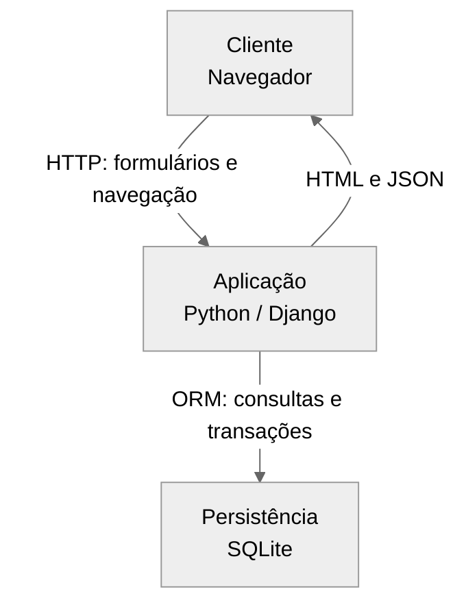
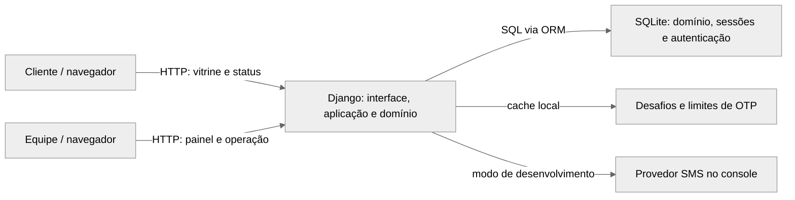
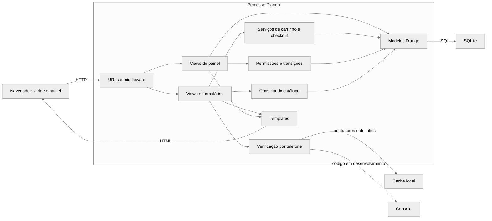
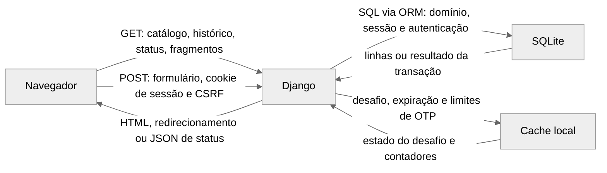
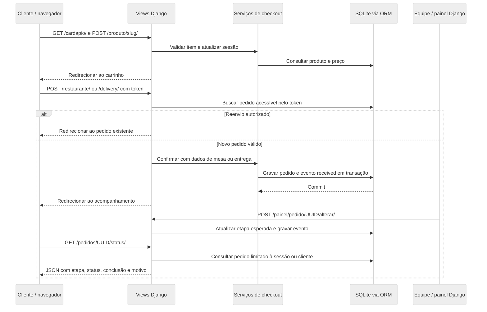
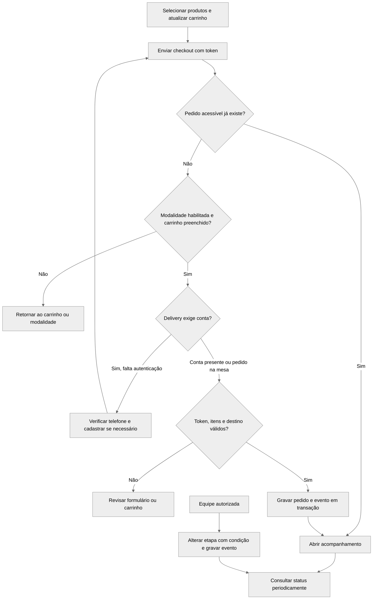

# Arquitetura e documentação técnica

Comece pelo [System Design](system-design.md). A [arquitetura do sistema](system-architecture.md) descreve o MVP e os componentes da integração distribuída e os [ADRs](architecture-decisions.md) registram as decisões de projeto.

| Tema | Navegação |
| --- | --- |
| Diagrama conceitual e alto nível | [Conceitual](#conceitual) · [Alto nível](#alto-nível) |
| Componentes e comunicação | [Componentes](#componentes) · [Comunicação](#comunicação) |
| Pedidos e dados | [Sequência e fluxo](#pedidos) · [Banco de dados](database.md) · [ERD](#banco-de-dados) |
| Execução e automação | [Guia local](../../apps/web/README.md) · [Docker](../deployment/docker-guide.md) · [CI/CD](../deployment/ci-cd.md) |
| Infraestrutura distribuída | [Diagrama AWS completo](aws-architecture.md) |

Os blocos renderizados reproduzem os arquivos `.mmd`. Ao alterar um diagrama, atualizar a cópia Markdown na mesma revisão. [Mermaid no GitHub](https://docs.github.com/en/get-started/writing-on-github/working-with-advanced-formatting/creating-diagrams)

## Conceitual

[Fonte Mermaid de arquitetura conceitual atual](diagrams/conceptual-architecture.mmd)

<details>
<summary>Arquitetura conceitual atual</summary>



</details>

## Alto nível

[Fonte Mermaid de alto nível atual](diagrams/high-level-architecture.mmd)

<details>
<summary>Alto nível atual</summary>



</details>

## Componentes

[Fonte Mermaid de componentes atuais](diagrams/component-diagram.mmd)

<details>
<summary>Componentes atuais</summary>



</details>

## Comunicação

[Fonte Mermaid de comunicação atual](diagrams/communication-diagram.mmd)

<details>
<summary>Comunicação atual</summary>



</details>

## Pedidos

[Fonte Mermaid de sequência real](diagrams/order-sequence.mmd)

<details>
<summary>Sequência real</summary>



</details>

[Fonte Mermaid de fluxo real com validações](diagrams/order-flow.mmd)

<details>
<summary>Fluxo real com validações</summary>



</details>

## Banco de dados

[Fonte Mermaid de erd do modelo atual](diagrams/database-erd.mmd)

<details>
<summary>ERD do modelo atual</summary>

```mermaid
---
config:
  theme: neutral
---
erDiagram
    shop_customer {
        bigint id PK
        varchar(11) phone UK
        varchar(100) name
        varchar(254) email
        json addresses
    }
    shop_order {
        uuid id PK
        uuid token UK
        varchar(64) owner
        bigint customer_id FK "nulo"
        varchar(12) mode
        json destination
        varchar(40) payment
        varchar(300) notes
        json items
        uint subtotal
        uint discount
        uint fee
        uint total
        usmallint stage
        datetime created
        datetime accepted_at "nulo"
        datetime ready_at "nulo"
        datetime paid_at "nulo"
        int accepted_by_id FK "nulo"
        varchar(300) reason
    }
    shop_orderevent {
        bigint id PK
        uuid order_id FK
        varchar(24) action
        int actor_id FK "nulo"
        varchar(300) reason
        datetime created
    }
    shop_category {
        bigint id PK
        varchar(80) name UK
        uint position
        boolean active
    }
    shop_menuproduct {
        bigint id PK
        varchar(50) slug UK
        varchar(100) name
        bigint category_id FK
        text description
        uint price
        uint discount
        varchar(500) image
        boolean available
        boolean archived
        uint prep_minutes
        json options
        json extras
    }
    shop_table {
        bigint id PK
        uint number UK
        varchar(60) label
        boolean active
        uuid qr_key UK
    }
    shop_ingredient {
        bigint id PK
        varchar(100) name UK
        varchar(20) unit
        decimal(12,3) quantity
        decimal(12,3) minimum
        datetime updated
    }
    shop_stockmovement {
        bigint id PK
        bigint ingredient_id FK
        decimal(12,3) delta
        varchar(300) reason
        int actor_id FK "nulo"
        datetime created
    }
    shop_restaurant {
        bigint id PK
        varchar(100) name
        varchar(200) logo
        varchar(240) address
        varchar(25) phone
        varchar(240) hours
        boolean accepting
        boolean delivery
        uint fee
        uint prep
        json payments
        uint alert_minutes
        boolean sound
    }
    auth_permission {
        int id PK
        varchar(255) name
        int content_type_id FK
        varchar(100) codename
    }
    auth_group {
        int id PK
        varchar(150) name UK
    }
    auth_user {
        int id PK
        varchar(128) password
        datetime last_login "nulo"
        boolean is_superuser
        varchar(150) username UK
        varchar(150) first_name
        varchar(150) last_name
        varchar(254) email
        boolean is_staff
        boolean is_active
        datetime date_joined
    }
    django_session {
        varchar(40) session_key PK
        text session_data
        datetime expire_date
    }
    django_content_type {
        int id PK
        varchar(100) app_label
        varchar(100) model
    }
    auth_user_groups {
        int id PK
        int user_id FK
        int group_id FK
    }
    auth_user_user_permissions {
        int id PK
        int user_id FK
        int permission_id FK
    }
    auth_group_permissions {
        int id PK
        int group_id FK
        int permission_id FK
    }
    shop_customer o|..o{ shop_order : "customer"
    auth_user o|..o{ shop_order : "accepted_by"
    shop_order ||..o{ shop_orderevent : "order"
    auth_user o|..o{ shop_orderevent : "actor"
    shop_category ||..o{ shop_menuproduct : "category"
    shop_ingredient ||..o{ shop_stockmovement : "ingredient"
    auth_user o|..o{ shop_stockmovement : "actor"
    django_content_type ||..o{ auth_permission : "content_type"
    auth_user ||..o{ auth_user_groups : "user"
    auth_group ||..o{ auth_user_groups : "group"
    auth_user ||..o{ auth_user_user_permissions : "user"
    auth_permission ||..o{ auth_user_user_permissions : "permission"
    auth_group ||..o{ auth_group_permissions : "group"
    auth_permission ||..o{ auth_group_permissions : "permission"
```

</details>
