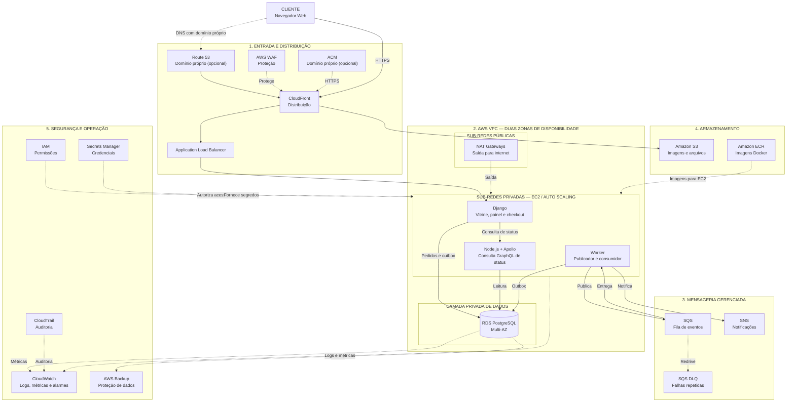

# Diagrama de infraestrutura AWS

O diagrama apresenta a configuração distribuída definida no Terraform para duas zonas de disponibilidade. A demonstração pública usa uma EC2 independente. [Estado da implantação](../deployment/status.md) [System Design](system-design.md#6-arquitetura-de-infraestrutura-aws) · [Fonte Mermaid editável](diagrams/aws-infrastructure.mmd)

O ALB usa sub-redes públicas. SQS, DLQ e SNS são serviços gerenciados externos às sub-redes. Com domínio próprio, o Route 53 resolve o nome e o ACM fornece o certificado. No modo padrão, o navegador usa o endereço HTTPS do CloudFront. O Django grava a outbox junto com o pedido, e o worker encaminha o evento ao SQS depois do commit. [Estratégia de outbox](system-design.md#5-arquitetura-de-mensageria)
