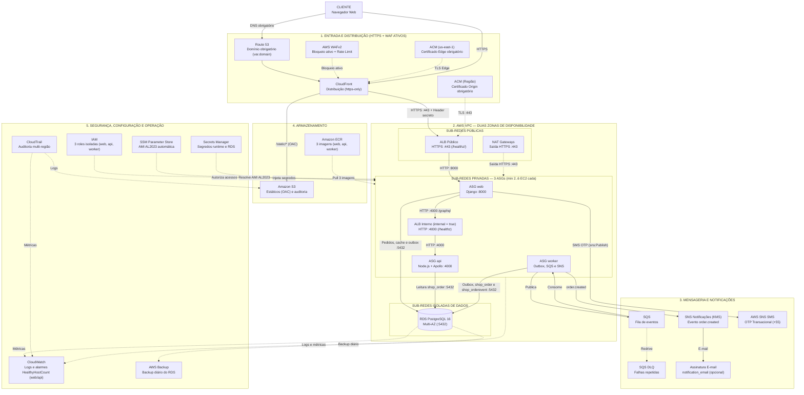

# Diagrama de infraestrutura AWS

O diagrama apresenta a configuração distribuída definida no Terraform para duas zonas de disponibilidade. A demonstração pública usa uma EC2 independente. [System Design](system-design.md#6-arquitetura-de-infraestrutura-aws) · [Fonte Mermaid editável](diagrams/aws-infrastructure.mmd)

- **Camada de entrada (R2)**: `var.domain` e `var.hosted_zone_id` são obrigatórios. O Route 53 resolve o domínio público (`A`/`AAAA` para o CloudFront) e valida dois certificados ACM via DNS: um em `us-east-1` (`edge`) para o CloudFront e outro regional (`origin.<domínio>`) para o ALB público. O AWS WAFv2 aplica `AWSManagedRulesCommonRuleSet` em modo de bloqueio ativo por padrão (`waf_enforce = true`, `none {}`) e limite de taxa (`2000` requisições por IP). O CloudFront encaminha o tráfego para o ALB público exclusivamente por HTTPS (`origin_protocol_policy = "https-only"` na porta `443`) com o cabeçalho secreto `X-ByteBistro-Origin`, enquanto `/static/*` é servido do S3 via OAC.
- **Rede, 3 ASGs e ALB interno (R1)**: A VPC abrange duas zonas de disponibilidade com sub-redes públicas (ALB público e NAT Gateways), sub-redes privadas (frotas e ALB interno) e sub-redes isoladas de dados (RDS PostgreSQL 16 Multi-AZ). Cada serviço executa em seu próprio Auto Scaling Group (`web`, `api` e `worker`, mínimo de 2 e máximo de 6 instâncias EC2 por frota quando `var.runtime != null`, total mínimo de 6 instâncias), com IAM Role, Launch Template e política de CPU dedicados (além de escalonamento por backlog SQS no `worker`). O ALB público (`443`) encaminha para o Target Group `web` (`HTTP :8000`, health check `/healthz/`). O Django (`web`) consulta a API Node.js + Apollo por meio do ALB interno (`aws_lb.api`, `internal = true`, sub-redes privadas, `HTTP :4000`, `BYTEBISTRO_GRAPHQL_URL=http://<api_alb_dns>:4000/graphql`), cujo Target Group verifica `GET /healthz` (HTTP `200` sem autenticação) enquanto `POST /graphql` exige `Authorization: Bearer`.
- **Mensageria, SMS e auditoria (R3)**: O Django grava pedidos, cache (`PostgresCache`) e registros de outbox no RDS; o `worker` encaminha eventos da outbox ao SQS (com DLQ) e consome a fila lendo `shop_order`, publicando payloads enriquecidos `order.created` no tópico SNS `notifications` (criptografado com KMS e conectado à assinatura opcional `aws_sns_topic_subscription.notifications` via `var.notification_email`) e gravando o evento `"notified"` em `shop_orderevent`. Para verificação por telefone em produção, a frota `web` usa `SnsSmsProvider` (`boto3` com `sns:Publish`) para enviar SMS transacionais diretamente pelo AWS SNS. [Estratégia de outbox](system-design.md#5-arquitetura-de-mensageria)
- **Operação, segurança e ativação simplificada (R4)**: Os Launch Templates resolvem automaticamente a AMI Amazon Linux 2023 via SSM Parameter Store (`data.aws_ssm_parameter.fleet_ami`) e injetam os segredos de runtime diretamente de `aws_secretsmanager_secret.runtime`. O CloudWatch centraliza logs dos três serviços, do CloudTrail (auditado também no S3) e alarmes — incluindo `HealthyHostCount` para os Target Groups `web` e `api`, idade/DLQ do SQS e armazenamento livre do RDS — enquanto o AWS Backup executa backups diários do PostgreSQL.
