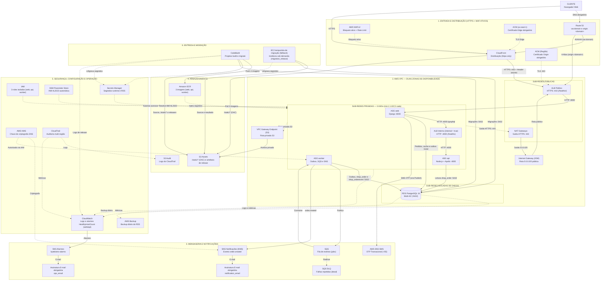

# Diagrama de infraestrutura AWS

O diagrama apresenta a configuração distribuída definida no Terraform para duas zonas de disponibilidade. [System Design](system-design.md#6-arquitetura-de-infraestrutura-aws) · [Fonte Mermaid editável](diagrams/aws-infrastructure.mmd)

- **Camada de entrada (R2)**: `var.domain` e `var.hosted_zone_id` são obrigatórios. O Route 53 resolve o domínio público (`A`/`AAAA` para o CloudFront), aponta `origin.<domínio>` (`A` Alias) para o ALB público e valida dois certificados ACM via DNS: um em `us-east-1` (`edge`) para o CloudFront e outro regional (`origin.<domínio>`) para o ALB público. O AWS WAFv2 aplica `AWSManagedRulesCommonRuleSet` em modo de bloqueio ativo por padrão (`waf_enforce = true`, `none {}`) e limite de taxa (`2000` requisições por IP). O CloudFront encaminha o tráfego dinâmico para o ALB público exclusivamente por HTTPS (`origin_protocol_policy = "https-only"` na porta `443`) com o cabeçalho secreto `X-ByteBistro-Origin`, enquanto `/static/*` é servido do bucket `S3 Assets` via OAC.
- **Rede, 3 ASGs e ALB interno (R1)**: A VPC abrange duas zonas de disponibilidade com `Internet Gateway (IGW)` conectado às sub-redes públicas (`ALB Público` e `NAT Gateways`), sub-redes privadas (frotas e `ALB Interno`) com saída HTTPS via NAT Gateways e `VPC Gateway Endpoint (S3)` para acesso privado ao bucket `S3 Assets`, além de sub-redes isoladas de dados (`RDS PostgreSQL 16 Multi-AZ`). Cada serviço executa em seu próprio Auto Scaling Group (`web`, `api` e `worker`, mínimo de 2 e máximo de 6 instâncias EC2 por frota quando `var.runtime != null`, total mínimo de 6 instâncias), com IAM Role, Launch Template e política de CPU dedicados (além de escalonamento por backlog SQS no `worker`). O ALB público (`443`) encaminha para o Target Group `web` (`HTTP :8000`, health check `/healthz/`). O Django (`web`) consulta a API Node.js + Apollo por meio do ALB interno (`aws_lb.api`, `internal = true`, sub-redes privadas, `HTTP :4000`, `BYTEBISTRO_GRAPHQL_URL=http://<api_alb_dns>:4000/graphql`), cujo Target Group verifica `GET /healthz` (HTTP `200` sem autenticação) enquanto `POST /graphql` exige `Authorization: Bearer`.
- **Mensageria, notificações e SMS (R3)**: O Django grava pedidos, cache (`PostgresCache`) e registros de outbox no RDS; o `worker` encaminha eventos da outbox ao SQS (`jobs`, com redrive para a DLQ `dead`) e consome a fila lendo `shop_order`, publicando payloads enriquecidos `order.created` no tópico `SNS Notificações` (`bytebistro-notifications`, criptografado com `AWS KMS` e autorizado via IAM para o `ASG worker`) com assinatura de e-mail obrigatória `notification_email`, além de gravar o evento `"notified"` em `shop_orderevent`. Para verificação por telefone em produção, a frota `web` usa `SnsSmsProvider` (`boto3` com `sns:Publish`) para enviar SMS transacionais diretamente pelo AWS SNS. Os alarmes do CloudWatch disparam notificações no tópico `SNS Alarmes` (`bytebistro-alarms`) conectado à assinatura de e-mail obrigatória `ops_email`. [Estratégia de outbox](system-design.md#5-arquitetura-de-mensageria)
- **Armazenamento, operação e segurança (R4)**: A camada de armazenamento separa dois buckets S3 privados e versionados — `S3 Assets` (`/static/*` via CloudFront OAC e artefatos de release) e `S3 Audit` (logs imutáveis do CloudTrail) — além dos 3 repositórios imutáveis do Amazon ECR (`web`, `api`, `worker`). Os Launch Templates resolvem automaticamente a AMI Amazon Linux 2023 via SSM Parameter Store (`data.aws_ssm_parameter.fleet_ami`) e injetam os segredos de runtime de `aws_secretsmanager_secret.runtime` (além da senha mestre gerenciada do RDS no Secrets Manager). A chave `AWS KMS` com rotação automática protege o tópico `SNS Notificações` e é autorizada via IAM para a frota `worker` (`kms:ViaService` para SNS). O CloudWatch centraliza logs (serviços, release e CloudTrail) e alarmes — incluindo `HealthyHostCount` para os Target Groups `web` e `api`, idade/DLQ do SQS e armazenamento livre do RDS — enquanto o CloudTrail multi-região registra auditoria no `S3 Audit` e no CloudWatch, e o AWS Backup executa backups diários do PostgreSQL.
- **Entrega e migração**: O `AWS CodeBuild` executa dois projetos gerenciados: `build` (lê o pacote em `S3 Assets`, publica as 3 imagens no `ECR` e envia `/static/*` e artefatos ao `S3 Assets`) e `migrate` (executa nas sub-redes privadas da VPC, lê/atualiza segredos no `Secrets Manager` e aplica migrações no `RDS PostgreSQL`). Como contingência quando o CodeBuild está indisponível, `var.migration_release` provisiona uma `EC2 temporária de migração` (`t3.micro` em sub-rede privada, com desligamento automático) que lê o artefato em `S3 Assets`, acessa o `Secrets Manager`, aplica as migrações no `RDS PostgreSQL` e grava o resultado em `S3 Assets`.
