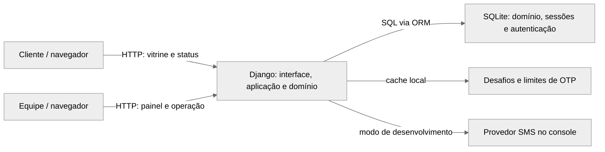
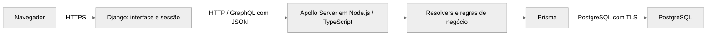

# Arquitetura do sistema

## Estado da implementação

| Estado | Componentes e evidência |
| --- | --- |
| Implementado na demonstração | Python e Django, templates HTML, CSS e JavaScript, rotas de vitrine e painel, ORM Django, migrações e SQLite. [Configuração](../../apps/web/config/settings.py) · [Rotas](../../apps/web/config/urls.py) · [Dependências](../../apps/web/requirements.txt) |
| Implementado no código distribuído | Django consulta o status via HTTP/GraphQL, mantém as regras de negócio, aplica as migrações do PostgreSQL e grava a outbox na mesma transação do pedido. Apollo/Prisma consulta o status e o worker integra SQS e SNS. [Serviços](../../apps/services/README.md) · [Banco](database.md) |
| Implantação | A demonstração pública usa uma EC2. Os artefatos do ambiente distribuído estão publicados e a ativação via CloudFront está pendente. [Estado da implantação](../deployment/status.md) |
| Empacotamento e verificação | Dockerfiles para web, API e worker. GitHub Actions configura as verificações de mudanças no código e o CodeBuild é definido no Terraform para releases. [CI/CD](../deployment/ci-cd.md) · [Infraestrutura](../../infrastructure/README.md) |
| Proposto | Transferir a escrita do domínio para Node.js e separar o esquema de negócio das tabelas de sessão e identidade do Django. [Contrato proposto](#contrato-proposto) |

[Fonte Mermaid](diagrams/high-level-architecture.mmd)

O Django renderiza as páginas, mantém carrinho e identidade do cliente em sessão, valida o checkout e grava pedidos. O painel usa usuários e grupos do Django, consulta os mesmos pedidos e aplica transições condicionadas ao estado anterior. O provedor de SMS de demonstração emite códigos no console em modo de desenvolvimento. [Checkout](../../apps/web/shop/services.py) · [Operação](../../apps/web/shop/operations.py) · [SMS](../../apps/web/shop/sms.py)

O modelo relacional atual inclui clientes, pedidos, eventos, categorias, produtos, mesas, insumos, movimentos de estoque e configuração do restaurante. Pedidos têm UUID, token único, valores em centavos e snapshots JSON dos itens e do destino. Produtos guardam referência a imagem estática ou URL HTTPS. As migrações Django criam o esquema e incluem dados iniciais de demonstração. [Modelos](../../apps/web/shop/models.py) · [Migrações](../../apps/web/shop/migrations/)

## Versões e configuração

- O manifesto declara Django `>=5.0.9,<6.0`. A demonstração local foi testada com Python 3.11. A suíte também passou na imagem web com Python 3.12. O Dockerfile dos serviços usa Node.js 22.
- O repositório contém Django, serviços TypeScript, schema Prisma para consulta e processamento da outbox, Dockerfiles e infraestrutura Terraform. [Infraestrutura AWS](../../infrastructure/terraform/README.md)
- A integração AWS usa o adaptador HTTP do Django somente no endpoint de acompanhamento. O adaptador envia a identidade do cliente obtida na sessão e autentica a chamada interna com um token de serviço. [Adaptador GraphQL](../../apps/web/shop/graphql.py)
- A demonstração usa `config.settings`. O contêiner Django para a configuração distribuída usa `config.aws_settings`. [Guia local](../../apps/web/README.md)

## Contrato proposto

O navegador continua usando a interface Django. O Django chama a API interna com identidade autenticada, timeouts e tratamento do campo GraphQL `errors`. Node.js mantém o monólito modular do domínio e assume validação de preços, autorização, pedidos, transições e eventos. Prisma passa a gerir o esquema do domínio. Se Django mantiver sessões e autenticação próprias, usará persistência compartilhada com tabelas, migrações e usuário separados dos do domínio.

A transição precisa preservar permissões, cálculo em centavos, idempotência do checkout e visibilidade dos pedidos no painel, com um único responsável por cada escrita durante o corte. A configuração distribuída já usa cache PostgreSQL para verificação de telefone. [Integração e evolução](../../apps/web/README.md#integração-e-evolução) · [Decisões](architecture-decisions.md)

[Django](https://docs.djangoproject.com/en/5.0/) · [Node.js](https://nodejs.org/docs/latest/api/) · [TypeScript](https://www.typescriptlang.org/docs/) · [Apollo Server](https://www.apollographql.com/docs/apollo-server/) · [Prisma](https://www.prisma.io/docs) · [PostgreSQL](https://www.postgresql.org/docs/)
