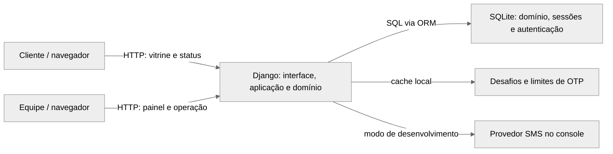
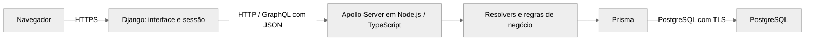

# Arquitetura do sistema

## Estado verificado no checkout

| Estado | Componentes e evidência |
| --- | --- |
| Implementado na demonstração | Python e Django, templates HTML, CSS e JavaScript, rotas de vitrine e painel, ORM Django, migrações e SQLite. [Configuração](../../client/config/settings.py) · [Rotas](../../client/config/urls.py) · [Dependências](../../client/requirements.txt) |
| Em desenvolvimento no cronograma | Backend Node.js e TypeScript. A pasta contém somente a descrição do componente. A avaliação de implementação está limitada ao checkout analisado. [Backend](../../backend/README.md) |
| Proposto | Apollo Server, schema e resolvers GraphQL, integração HTTP a partir do Django, Prisma e PostgreSQL. Docker e GitHub Actions também pertencem ao desenho futuro. [Banco](../../database/README.md) · [Infraestrutura](../../infrastructure/README.md) |

[Fonte Mermaid](diagrams/high-level-architecture.mmd)

O Django renderiza as páginas, mantém carrinho e identidade do cliente em sessão, valida o checkout e grava pedidos. O painel usa usuários e grupos do Django, consulta os mesmos pedidos e aplica transições condicionadas ao estado anterior. O provedor de SMS de demonstração emite códigos no console em modo de desenvolvimento. [Checkout](../../client/shop/services.py) · [Operação](../../client/shop/operations.py) · [SMS](../../client/shop/sms.py)

O modelo relacional atual inclui clientes, pedidos, eventos, categorias, produtos, mesas, insumos, movimentos de estoque e configuração do restaurante. Pedidos têm UUID, token único, valores em centavos e snapshots JSON dos itens e do destino. Produtos guardam referência a imagem estática ou URL HTTPS. As migrações Django criam o esquema e incluem dados iniciais de demonstração. [Modelos](../../client/shop/models.py) · [Migrações](../../client/shop/migrations/)

## Versões, configuração e divergências

- O manifesto declara Django `>=5.0.9,<6.0`. A suíte foi validada com Python 3.11 e Django 5.0.9. O repositório não fixa a versão do Python ou do SQLite.
- O código versionado é Python, HTML, CSS e JavaScript de navegador. As pastas de backend, banco e infraestrutura contêm documentação. A inspeção não encontrou manifestos Node, schema Prisma, Dockerfiles, Compose ou workflows registrados.
- O desenho anterior citava Tkinter, Requests, SQLite via Prisma. A interface atual usa Django, o navegador chama o próprio Django e a persistência usa o ORM Django. O adaptador HTTP e os runtimes da proposta ainda precisam de versões e configuração.
- O WSGI e as rotas usam `config.settings`. O [guia local](../../client/README.md) descreve a configuração da demonstração.

## Contrato proposto

O navegador continua usando a interface Django. O Django chama a API interna com identidade autenticada, timeouts e tratamento do campo GraphQL `errors`. Node.js mantém o monólito modular do domínio e assume validação de preços, autorização, pedidos, transições e eventos. Prisma passa a gerir o esquema do domínio. Se Django mantiver sessões e autenticação próprias, usará persistência compartilhada com tabelas, migrações e usuário separados dos do domínio.

A transição precisa preservar permissões, cálculo em centavos, idempotência do checkout e visibilidade dos pedidos no painel, com um único responsável por cada escrita durante o corte. O cache de verificação de telefone exige armazenamento compartilhado com operações atômicas. [Roteiro de integração](../../client/README.md#integração-futura) · [Decisões](architecture-decisions.md)

[Django](https://docs.djangoproject.com/en/5.0/) · [Node.js](https://nodejs.org/docs/latest/api/) · [TypeScript](https://www.typescriptlang.org/docs/) · [Apollo Server](https://www.apollographql.com/docs/apollo-server/) · [Prisma](https://www.prisma.io/docs) · [PostgreSQL](https://www.postgresql.org/docs/)
